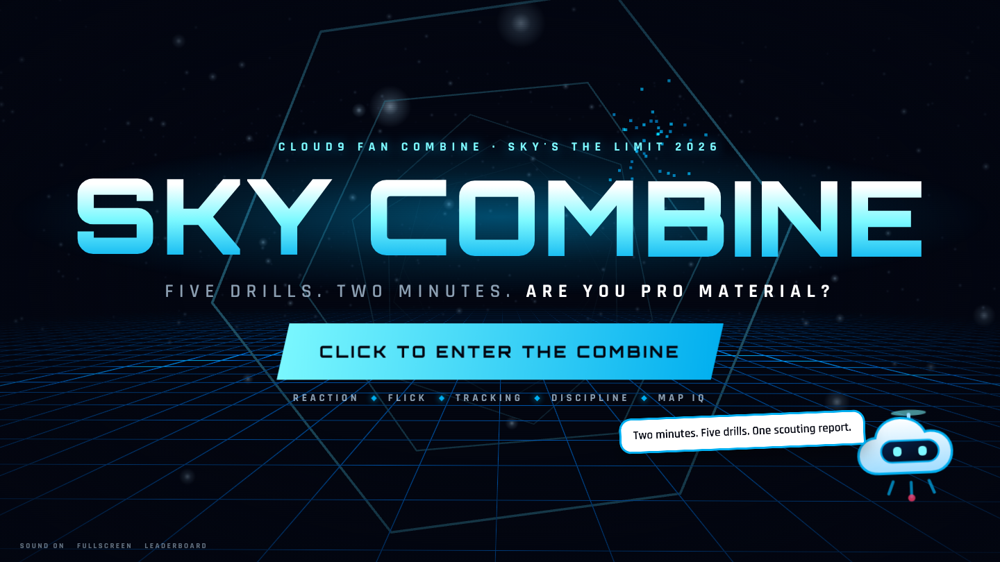
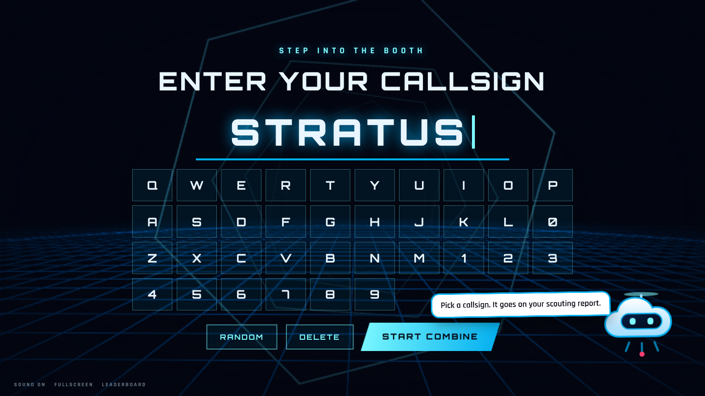
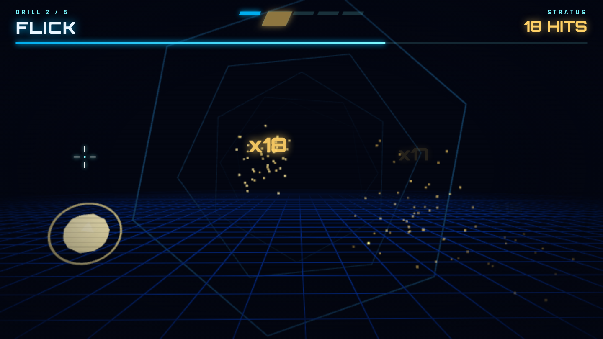
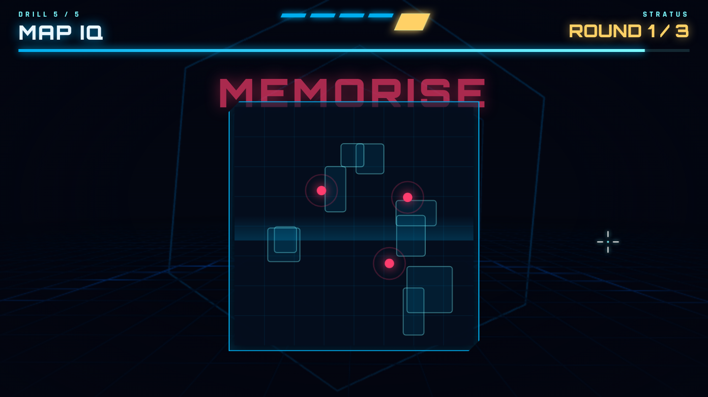
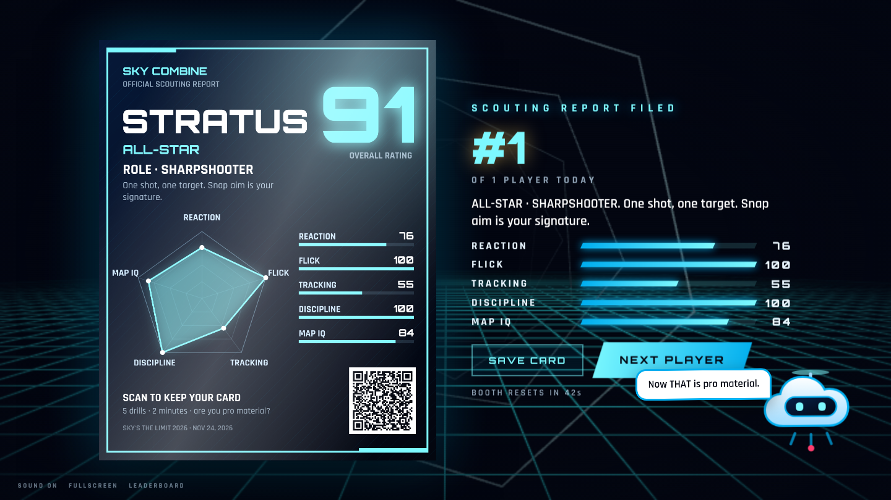
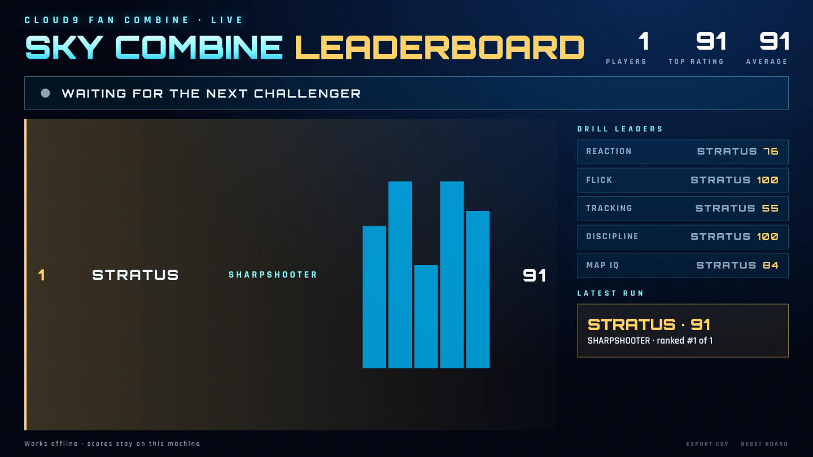

# Sky Combine

**Five drills. Two minutes. Are you pro material?**

Sky Combine is a booth mini game for esports events: a fan walks up, grabs the mouse, and runs the same five skills a scout looks for in a pro. Two minutes later they walk away with a scouting report card and a place on the big-screen leaderboard.

Built for [Cloud9 x JetBrains: Sky's the Limit 2026](https://cloud9.devpost.com/), Category 3 (Event Mini Game).



## The loop

| Step | What the fan does | Time |
| --- | --- | --- |
| Callsign | Types or clicks a name (or hits RANDOM) | 5 s |
| Reaction | Clicks the moment the sky turns blue; false starts cost points | ~15 s |
| Flick | Snaps to targets as they appear; accuracy counts | 15 s |
| Tracking | Keeps the crosshair locked on a weaving drone | 15 s |
| Discipline | Shoots red hostiles, holds fire on blue teammates | 15 s |
| Map IQ | Memorises minimap pings, then places them from memory | ~20 s |
| Scouting report | Rating, tier, role archetype, radar chart, QR code to take the card home | - |

Nimbus, the scout drone, talks the player through every step, so the booth needs no staff explanation.

| | |
| --- | --- |
|  |  |
|  |  |

## Made for a booth

- **Mouse only.** Every screen, including the callsign keyboard, works with one hand on the mouse.
- **No network needed.** Scores live in the browser; after the first load the game runs offline (service worker + PWA).
- **Second-monitor leaderboard.** Open `board.html` in another window on the same machine: it updates live as people play and shows who is in the booth right now.
- **Runs itself.** Left alone, the attract screen starts a demo run played by Nimbus (not ranked); any click hands control to the next fan. A finished run resets on its own.
- **Operator tools.** Export the day's scores as CSV, reset the board (two-step confirm), mute (`M`), fullscreen (`F`).
- **Any hardware.** Render quality steps down automatically on slow GPUs so input stays responsive.
- **No licensed content.** All art is original, all sound is synthesised at runtime, and no game or match data is used.



## Run it

```bash
npm ci
npm run dev        # http://localhost:5173
npm test           # scoring and leaderboard unit tests
npm run build      # static site in dist/, host anywhere
```

Useful URL parameters: `?demoAfter=10` (seconds idle before the demo run starts), `?seed=7` (repeatable target pattern), `?q=1` or `?q=2` (force lower render quality).

## How it is built

- **Vite + TypeScript**, no framework: the whole game is a static site.
- **Three.js** for the arena (shader grid, particle bursts, bloom), with a DOM HUD on top.
- **WebAudio** for all sound effects and music, generated in code.
- **Scoring** (`src/core/scoring.ts`) is pure and unit tested: each drill maps to 0-100, the overall rating (40-99) blends the average of the five (80%) with the best one (20%), and the role archetype is the player's strongest skill, or Flex when all five are close.
- **Leaderboard** (`src/core/store.ts`) uses `localStorage` plus `BroadcastChannel` to keep the game and the board window in sync.
- **Report card** is drawn to a canvas, so it can be saved as a PNG; the QR code carries the whole result in the link, so no backend stores it. The link points at wherever the game is hosted; for a booth running from a local file server, set `VITE_SHARE_URL` at build time to the public copy of the game.

## Licence

[MIT](LICENSE)
